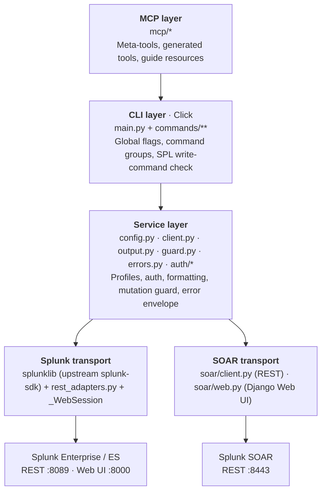
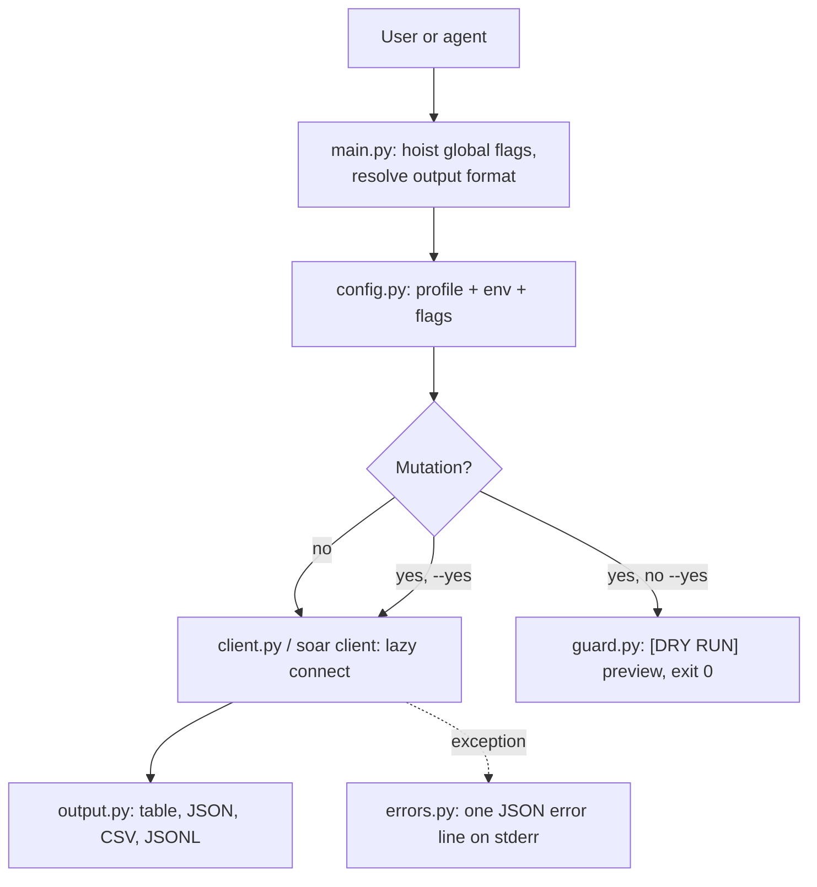

<!-- summary: How splunkctl is built: the layers, the request flow, auth resolution, and the design decisions behind them. -->

# Architecture

How splunkctl is built: the layers, the request flow, and the design
decisions. The command surface itself is documented in the generated
[command reference](../commands/README.md).

## Layers

One file per command group under `splunkctl/commands/`, with SOAR groups
under `splunkctl/commands/soar/`. Files stay under 500 lines; a group
that outgrows that splits into sibling modules (for example
`rules.py`, `rules_io.py`, `rules_schedule.py`).

The MCP server does not import command modules. Each tool call builds a
`splunkctl` argv and runs the CLI as a subprocess, so the CLI is the
single implementation and the MCP tools can never drift from it.

## Request flow

Global flags (`--json`, `--format`, `--profile`, `--config`, `--yes`,
`--dry-run`, ...) are accepted anywhere on the command line. `main.py`
moves them in front of the command before Click parses, stopping at `--`
and never touching a value that belongs to a subcommand option.

## Configuration

- Default file: `~/.splunkctl/config.yaml`, schema v2 (`profiles:` plus
  `current:`). Each profile holds the SIEM connection and an optional
  `soar:` section. Written with mode 0600 through a temp file and
  `os.replace`.
- Precedence, highest first: CLI flags, environment (`SPLUNK_HOST`,
  `SPLUNK_PORT`, `SPLUNK_SCHEME`, `SPLUNK_USER`, `SPLUNK_PASS`,
  `SPLUNK_TOKEN`, `SPLUNK_APP`, `SPLUNK_OWNER`, `SPLUNK_VERIFY`, and the
  `SOAR_*` equivalents), then the profile. The guard banner names the
  layer that supplied the credentials.
- Coexistence with Splunk's Go CLI: both tools default to
  `~/.splunkctl/config.yaml`. If that file is a flat `host`/`token`
  document written by the other tool, splunkctl treats it as foreign,
  falls back to `~/.splunkctl/profiles.yaml`, and prints one notice.
  Details in [Relationship to Splunk's splunkctl](../guides/splunk-cli.md).

## Authentication

Default is username/password or a bearer token from the profile.
Resolution happens lazily on the first API call; help, `config`, `commands`
and `docs` never connect.

Browser SAML is opt-in per profile (`auth_mode: browser`). `auth login`
opens a temporary Chromium through Playwright, keeps only the product
cookies, and stores a session under `~/.splunkctl/sessions/` with mode
0600. On use, the client validates the stored session first, then falls
back to token or password if the login route is no longer SAML. Module
roles:

| Module | Role |
|---|---|
| `auth/detector.py` | Classifies the public login route as SAML or password; never uses stored credentials |
| `auth/broker.py` | Headed browser login, identity-provider cookies discarded |
| `auth/adapters.py` | Turns browser cookies into a Splunk session key or a SOAR Django session |
| `auth/session.py` | Session records, store, target resolution |

SOAR prefers the `ph-auth-token` header and falls back to HTTP Basic for
`DELETE`, which the server refuses for tokens. See
[SOAR REST API notes](soar-api.md).

## Remote-first design

The CLI runs on the engineer's workstation and operates a remote
instance. It never assumes filesystem access to the server. Everything
goes through the REST API, with the Web UI used only where REST has gaps:

| Operation | Why REST fails | Path used |
|---|---|---|
| Lookup upload | `eai:data` requires a server-side path | `POST /manager/{app}/data/lookup-table-files/_new` |
| App install | REST expects a server-side file path | `POST /manager/appinstall/_upload` |
| SOAR playbook delete | No working REST route on 8.5 | Django login, then `POST /playbooks` |

`_WebSession` in `client.py` handles Splunk Web login, CSRF and multipart
upload. It honors the profile's `web_url` when the Web UI is not on the
API host. `soar/web.py` does the same for SOAR.

## REST adapters

`splunkctl/rest_adapters.py` provides the three entity collections that
upstream `splunk-sdk` lacks, over the SDK's authenticated transport:

| Entity | Endpoint | Client property |
|---|---|---|
| `Dashboard` | `data/ui/views` | `client.dashboards` |
| `LookupTableFile` | `data/lookup-table-files` | `client.lookup_table_files` |
| `HECToken` | `data/inputs/http` | `client.hec_tokens` |

Mutations use the entity's own `links.alternate` path returned by the
server, so names with special characters and app, global and system
sharing all route correctly. Other configuration objects use the SDK's
generic `service.confs` API or raw REST helpers in `client.py`.

## Safety model

- **Dry-run by default.** Every mutating command previews and exits 0
  unless `--yes` is given. `@guarded` marks these commands so the
  `commands --json` tree and the MCP tool schemas expose the gate.
- **SPL write commands.** `search run`, `export` and `oneshot` refuse SPL
  that contains `outputlookup`, `collect`, `sendalert`, `delete` and the
  other write commands in `spl_safety.py` unless `--yes` is given; the
  refusal is a `confirmation_required` error with exit 1.
- **Secrets.** Config is redacted on `config show`; SOAR asset previews
  mask keys that look like passwords or tokens; session values never
  appear in error strings.
- **Error envelope.** In JSON mode every failure is one stderr line with
  `kind` (auth, permission, not_found, conflict, http, connection,
  timeout, config, confirmation_required), `http_status` and `message`.
  See [Exit codes](../guides/exit-codes.md).

## Agent access

`mcp serve` exposes the CLI over MCP. Five meta-tools (`help`, `usage`,
`focus`, `unfocus`, `run`) give progressive discovery; `focus` registers
one command group as typed tools generated from the Click tree. The guides
in `docs/guides/` ship inside the package as MCP resources. Transport is
stdio by default; `--transport http` binds loopback only and has no
authentication, which is why it is documented for a single-user machine.
`docs/llms.txt`, `docs/llms-full.txt` and `docs/commands.json` serve the
same content to agents that read the website instead.

## Design principles

1. **Dry-run by default.** Mutations preview before they apply.
2. **Dual output.** TTY gets tables, pipes get JSON. Always overridable.
3. **Lazy everything.** Auth, SDK connection and config loading are
   deferred until needed.
4. **One implementation.** MCP, docs and the command tree all derive from
   the Click CLI.
5. **SDK-first.** Use the SDK where it works; adapters and Web UI
   workarounds only for documented gaps.
6. **Remote-first.** Never touch the server's filesystem.
7. **Agent-friendly.** Machine-readable output, self-discovery, docs that
   read well raw.
